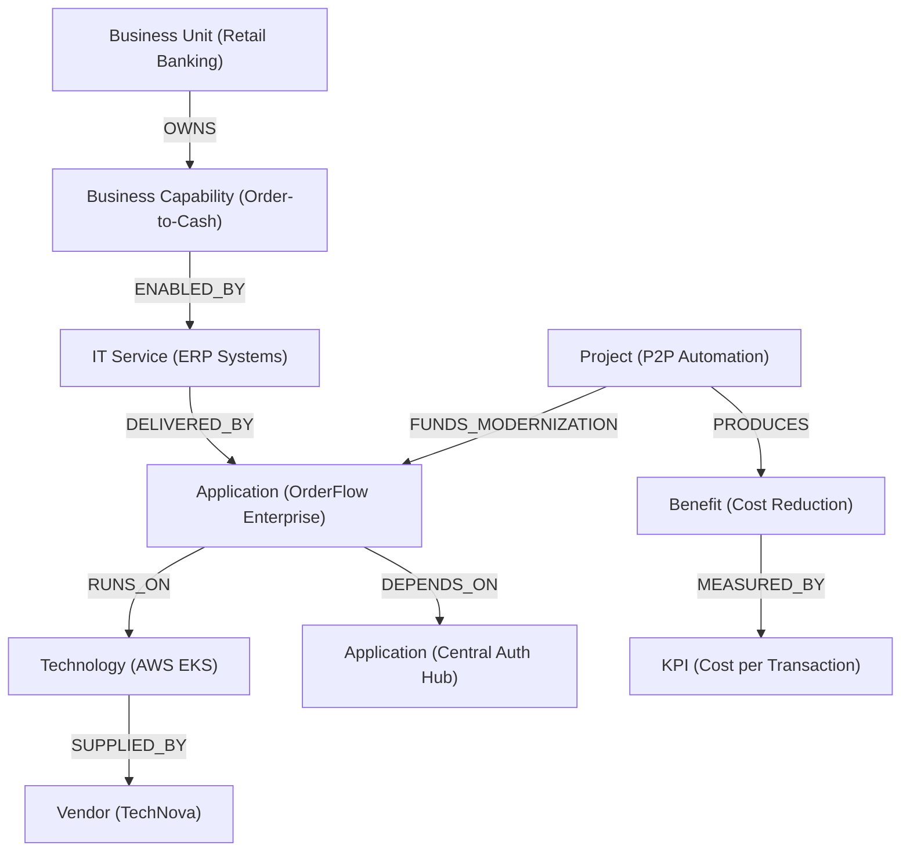

# Technology Value Intelligence (TVI)

**TBM / ITFM / Technology Value Realization Local-First Prototype**

A portfolio-grade, local-first analytical engine and Knowledge Graph architecture. It demonstrates how a Knowledge Graph transforms Technology Business Management (TBM) and IT Financial Management (ITFM) from static, retroactive cost accounting into proactive, relationship-aware **Technology Value Realization (TVR)**.

---

## 1. Executive Summary

Enterprise technology management today suffers from disconnected data silos:
- **Finance (GL):** Tracks *what was bought* (e.g. servers, software licenses, contractors), but cannot identify *which business capability it enables*.
- **Enterprise Architecture (EA):** Tracks applications, services, and capabilities, but lacks granular monthly cost attribution and unit economics.
- **Infrastructure & FinOps:** Tracks compute hours, storage volumes, and API calls, but cannot quantify the business impact or revenue contribution of those workloads.
- **PMO & Transformation:** Tracks capital investments, but rarely audits whether expected post-delivery benefits actually materialize.

**Technology Value Intelligence (TVI)** bridges these domains:

```text
Technology Cost (Financial GL)
          ↓
     Application
          ↓
      IT Service
          ↓
  Business Capability
          ↓
  Business Consumption
          ↓
 Business / Operational KPI
          ↓
   Technology Value
```

---

## 2. Why Knowledge Graphs for TBM / ITFM?

Relational databases (SQL / DuckDB) excel at columnar aggregations, financial rollups, and time-series variance analysis. However, answering multi-hop enterprise dependency questions using relational tables requires complex, brittle joins across 6–8 tables.

A **Knowledge Graph** models applications, services, capabilities, technologies, vendors, and business units as first-class nodes connected by semantic directed edges:



### Key Questions Answered by the Graph:
1. **What does a business capability actually cost?** (Attributing direct app TCO and proportional shared infrastructure without double-counting).
2. **Which applications have overlapping capabilities?** (Pinpointing duplicate systems supporting the same business capability).
3. **What is the true decommissioning blast radius?** (Tracing direct and transitive upstream and downstream dependencies before retiring an application).
4. **Who consumes technology supplied by Vendor X?** (Multi-hop path traversal from vendor invoices to end-user business units).
5. **Are investment benefits being realized?** (Connecting project capex to post-implementation KPI movements).

---

## 3. Architecture & Separation of Concerns

TVI enforces a strict three-layer architectural separation:

```text
┌─────────────────────────────────────────────────────────────┐
│                       AI & INTERFACE                        │
│   • "Vedanam" Nuxt 4 Web Experience (Three.js, GSAP, CSS)   │
│   • Dual-Mode Knowledge Graph Analyst (llm.py)              │
│   • Deterministic Rules Mode (Default, Zero Hallucination)  │
│   • Optional Local Ollama LLM Mode                          │
└──────────────────────────────┬──────────────────────────────┘
                               │
                               ▼
┌─────────────────────────────────────────────────────────────┐
│                      ANALYTICS LAYER                        │
│   • Application TCO & Unit Economics (cost_analytics.py)    │
│   • Proportional Capability Attribution (cost_analytics.py) │
│   • Multi-Criteria Rationalization MCDA (rationalization.py)│
│   • Transitive Blast Radius Engine (dependency.py)          │
│   • Benefit Realization & Gap Engine (value_realization.py) │
│   • Cost Driver Variance Decomposition (variance.py)        │
└──────────────┬───────────────────────────────┬──────────────┘
               │                               │
               ▼                               ▼
┌──────────────────────────────┐┌─────────────────────────────┐
│       ANALYTICAL TRUTH       ││  RELATIONSHIP INTELLIGENCE  │
│          (DuckDB)            ││         (NetworkX)          │
│  • High-performance OLAP     ││  • Typed property graph     │
│  • Materialized views        ││  • Multi-hop traversals     │
│  • Exact financial sums      ││  • Focused subgraphs        │
└──────────────────────────────┘└─────────────────────────────┘
```

### Statistical Synthetic Data Generation Architecture (Levels 1–7)
TVI includes a multi-tiered synthetic enterprise generator (`src/tvi/data_generation.py`) combining:
- **Level 1 (Static Master Lookups):** Canonical entity definitions across business units, capabilities, services, technologies, and vendors.
- **Level 2 (Seeded Deterministic PRNG):** Strict seed pinning (`random_seed: 42`) for execution-invariant dataframes across platforms.
- **Level 3 (Rule-Based Scenarios):** Explicit business archetypes and pathologies (Scenarios A through H).
- **Level 4 (Parametric Distributions - `distributions.py`):** Heavy-tailed Log-Normal application spend, Beta investment realization, Gamma compute/storage usage, Dirichlet cost-pool allocations, and Truncated Normal shared infrastructure.
- **Level 5 (Time-Series Dynamics & Drift):** Compound monthly growth trends (+1.5%/mo), Q4 festive/fiscal spikes, and Gaussian noise.
- **Level 6 (Gaussian Copulas - `copulas.py`):** Sklar's theorem-based joint dependency modeling with Greiner's Spearman-to-Pearson conversion and PSD eigenvalue projection for multi-metric operational telemetry correlations.
- **Level 7 (Graph Topology & Ontology):** Referential integrity mapped across 16 typed semantic relationships defined in `ontology.yaml`.

---

## 4. The 12-Notebook Progressive Curriculum

All 12 notebooks follow an 8-part consulting research framework (Business Problem, Core Concept, Data Model, Implementation, Results, Interpretation, Limitations, Next Steps):

| # | Notebook | Focus & Core Methodology |
| :-: | :--- | :--- |
| **01** | [`01_generate_enterprise_data.ipynb`](notebooks/01_generate_enterprise_data.ipynb) | Deterministic synthetic enterprise generation embedding all 25 business scenarios across 3 tiers (Basic A–H, Intermediate I–Q, Advanced R–Y) at real-world enterprise scale (4,952 GL cost records, 2,400 multi-channel telemetry streams, 2,400 cloud billing line items), Level 4 parametric statistical distributions (Log-Normal, Gamma, Beta, Dirichlet, Truncated Normal), Level 6 Gaussian copula correlation modeling, and referential validation. |
| **02** | [`02_tbm_itfm_data_model.ipynb`](notebooks/02_tbm_itfm_data_model.ipynb) | Ingesting master data and financial ledgers into an in-process DuckDB columnar warehouse; Parquet export pipelines, zero-copy Arrow queries, streaming ingestion, and migrations. |
| **03** | [`03_build_knowledge_graph.ipynb`](notebooks/03_build_knowledge_graph.ipynb) | NetworkX property graph construction; typed node and edge distribution validation; Neo4j Cypher DDL export, spectral graph embeddings, temporal dynamics, and Cytoscape.js. |
| **04** | [`04_application_cost_intelligence.ipynb`](notebooks/04_application_cost_intelligence.ipynb) | Fully-burdened application TCO, 2-stage Activity-Based Costing (ABC), price escalation sensitivity, FinOps unit economics benchmarks, and TCO forecasts. |
| **05** | [`05_capability_cost_intelligence.ipynb`](notebooks/05_capability_cost_intelligence.ipynb) | Capability-based costing, dynamic allocation rules, nested 3-tier taxonomy (L1-L3), cloud migration what-if simulator, and mathematical reconciliation audits. |
| **06** | [`06_consumption_intelligence.ipynb`](notebooks/06_consumption_intelligence.ipynb) | Multidimensional telemetry profiling, 2x2 quadrants, STL time-series decomposition, serverless auto-scaling metrics, GreenOps CO2e, and automated rightsizing. |
| **07** | [`07_application_rationalization.ipynb`](notebooks/07_application_rationalization.ipynb) | Multi-Criteria Decision Analysis (MCDA); Rationalization Review Index (RRI); MCDA sensitivity analysis, migration complexity vs savings Pareto frontier, phased decommissioning roadmaps, and contractual exit penalty modeling. |
| **08** | [`08_dependency_and_impact_analysis.ipynb`](notebooks/08_dependency_and_impact_analysis.ipynb) | Direct vs transitive reverse graph traversal; Single Point of Failure (SPOF) bottleneck identification; Monte Carlo cascading outage simulations, automated CI/CD release deployment gating, and Zero-Trust network containment audits. |
| **09** | [`09_investment_benefit_realization.ipynb`](notebooks/09_investment_benefit_realization.ipynb) | Capital investment budget variance; expected vs realized benefit gap analysis; discounted cash flow valuation (NPV, IRR, Payback), econometric Difference-in-Differences (DiD), and capability maturity progression. |
| **10** | [`10_cost_driver_and_variance_analysis.ipynb`](notebooks/10_cost_driver_and_variance_analysis.ipynb) | Month-over-Month (MoM) spend shift decomposition; rolling Z-score & IsolationForest cost anomaly detection, contractual SLA breach penalty calculations, forward budget variance forecasting with 90% confidence bands, and automated FinOps ticket generation. |
| **11** | [`11_local_llm_knowledge_graph_analyst.ipynb`](notebooks/11_local_llm_knowledge_graph_analyst.ipynb) | Guarded natural language interface; conversational session memory with anaphora pronoun resolution; expanded analytical intents (blast radius gating, SLA penalties, decommissioning roadmap, capability maturity); zero arbitrary code execution; and automated executive briefing slide generation. |
| **12** | [`12_end_to_end_technology_value_intelligence.ipynb`](notebooks/12_end_to_end_technology_value_intelligence.ipynb) | Complete end-to-end value chain traversal; synthesis of the formal 9-section Board-level Executive Report for the CIO & CFO; self-contained executive HTML briefing export, structured 5-slide JSON presentation deck, Slack/Teams webhook payloads, external industry quartile benchmarks, and strategic portfolio rebalancing simulation. |

---

## 5. Executive & Technical Publication Series (`blog/`)

The repository includes two specialized publication tracks located in the [`blog/`](blog/README.md) portal:

### 💼 Executive Business Series (`blog/business/`)
For non-technical, business-oriented leaders (CFOs, CIOs, Business Unit Presidents, Corporate Controllers, and Board Directors), [`blog/business/`](blog/business/README.md) houses a **24-article executive publication series** optimized for organic search discovery, Google Search Generative Experience, and boardroom strategy:

| Notebook | Focus & Core Theme | Executive Article 1 (Strategy & Foundations) | Executive Article 2 (Operational Deep-Dives) |
| :---: | :--- | :--- | :--- |
| **01** | Enterprise Data & Scenarios | [**01a:** Digital Twins for IT Leadership](blog/business/01a_digital_twins_for_it_leadership.md) | [**01b:** 8 Hidden IT Spend Pathologies](blog/business/01b_the_eight_pathologies_of_enterprise_tech_spend.md) |
| **02** | TBM / ITFM Data Warehouse | [**02a:** TBM Taxonomy Explained](blog/business/02a_from_gl_invoices_to_business_capabilities.md) | [**02b:** Speed-of-Thought Auditing](blog/business/02b_zero_reconciliation_financial_truth.md) |
| **03** | Knowledge Graph Construction | [**03a:** Graphs vs Spreadsheets](blog/business/03a_why_spreadsheets_fail_and_graphs_win.md) | [**03b:** Vendor Lineage to Revenue](blog/business/03b_the_enterprise_nervous_system_lineage.md) |
| **04** | Application TCO & Unit Economics | [**04a:** Fully-Burdened App TCO](blog/business/04a_demystifying_fully_burdened_application_tco.md) | [**04b:** Workhorses vs Zombies](blog/business/04b_unit_economics_workhorses_vs_zombie_systems.md) |
| **05** | Capability Costing & Duplication | [**05a:** What Does Capability Cost?](blog/business/05a_what_does_a_business_capability_actually_cost.md) | [**05b:** Unmasking Redundancy Trap](blog/business/05b_unmasking_the_redundancy_trap_duplicate_apps.md) |
| **06** | Consumption & Utilization | [**06a:** 2x2 Utilization Matrix](blog/business/06a_the_2x2_utilization_quadrant_matrix.md) | [**06b:** Elasticity & GreenOps](blog/business/06b_elasticity_and_sustainable_greenops.md) |
| **07** | Application Rationalization | [**07a:** Objective Pruning (MCDA/TIME)](blog/business/07a_objective_portfolio_pruning_mcda_and_time.md) | [**07b:** Decommissioning Playbook](blog/business/07b_the_pragmatic_decommissioning_playbook.md) |
| **08** | Blast Radius & Dependency Impact | [**08a:** The Domino Effect (Blast Radius)](blog/business/08a_the_domino_effect_transitive_blast_radius.md) | [**08b:** Taming Single Points of Failure](blog/business/08b_single_points_of_failure_and_resilience.md) |
| **09** | Investment Value Realization | [**09a:** Beyond On-Time & Budget (TVR)](blog/business/09a_beyond_on_time_and_on_budget_tvr.md) | [**09b:** Payments vs CRM Transformation](blog/business/09b_a_tale_of_two_transformations_payments_vs_crm.md) |
| **10** | Variance & Cost Drivers | [**10a:** Why Did Our IT Bill Spike?](blog/business/10a_why_did_our_it_bill_spike_variance_decomposition.md) | [**10b:** Algorithmic FinOps Governance](blog/business/10b_algorithmic_governance_anomalies_and_sla_credits.md) |
| **11** | Grounded Local AI Analyst | [**11a:** Grounded AI with Graphs](blog/business/11a_chatting_with_the_enterprise_grounded_ai.md) | [**11b:** Zero-Hallucination On-Premise AI](blog/business/11b_zero_hallucination_on_premise_intelligence.md) |
| **12** | Unified Value Chain & Boardroom | [**12a:** Unified Technology Value Chain](blog/business/12a_the_unified_technology_value_chain.md) | [**12b:** CIO & CFO Board Playbook](blog/business/12b_the_cio_cfo_executive_board_playbook.md) |

#### 🎯 Role-Tailored Executive Reading Tracks:
- **💼 CFO & Controller Track**: `01b` $\to$ `02a` $\to$ `02b` $\to$ `04a` $\to$ `04b` $\to$ `05a` $\to$ `07b` $\to$ `09a` $\to$ `10a` $\to$ `12b` *(Financial mass balance, TCO, unit economics, PVM variance, board governance)*
- **💻 CIO & CTO Track**: `01a` $\to$ `01b` $\to$ `03a` $\to$ `03b` $\to$ `07a` $\to$ `08a` $\to$ `08b` $\to$ `11a` $\to$ `11b` $\to$ `12a` $\to$ `12b` *(Digital twins, graphs, TIME pruning, blast radius, grounded AI)*
- **📈 Business Unit President Track**: `01a` $\to$ `04b` $\to$ `05a` $\to$ `05b` $\to$ `06a` $\to$ `07a` $\to$ `09a` $\to$ `09b` $\to$ `12a` *(Capability costing, software redundancy, 2x2 quadrants, transformation TVR)*
- **⚡ FinOps Director Track**: `01b` $\to$ `04a` $\to$ `04b` $\to$ `06a` $\to$ `06b` $\to$ `07b` $\to$ `10a` $\to$ `10b` $\to$ `11a` *(Spend pathologies, unit economics, GreenOps, PVM decomposition, SLA clawbacks)*

*For full summaries, chapter breakdowns, and persona guides, consult the [`blog/business/README.md`](blog/business/README.md) index.*

### 🛠️ Developer & Engineering Deep Dives (`blog/technical/`)
For software engineers, data architects, and quantitative analysts, [`blog/technical/`](blog/technical/README.md) houses an exhaustive **42-part technical implementation curriculum (3 to 5 deep guides per notebook)**. Each guide is written from first principles for engineers new to Technology Business Management (TBM), explaining the domain problem, mathematical derivations (Sklar's theorem copulas, Brandes centrality, PVM variance algebra, DiD econometrics, SIMD vectorized execution, TOPSIS MCDA), line-by-line code breakdowns, architectural alternatives considered, local 16 GB laptop resource constraints, and production scaling roadmaps.

| Notebook | Technical Guide Series (3 to 5 Guides per Notebook) | Core Concepts & Mathematical Topics |
| :--- | :--- | :--- |
| **01** | [`01a`](blog/technical/01a_tbm_foundations_and_synthetic_enterprise_modeling.md), [`01b`](blog/technical/01b_statistical_distributions_and_heavy_tailed_telemetry.md), [`01c`](blog/technical/01c_copulas_and_multivariate_correlation_modeling.md), [`01d`](blog/technical/01d_scenario_injection_and_referential_integrity_pipeline.md) | TBM paradox, Beta/Weibull/Log-Normal distributions, Sklar's theorem copulas, 25 scenarios |
| **02** | [`02a`](blog/technical/02a_tbm_taxonomy_and_relational_accounting_foundations.md), [`02b`](blog/technical/02b_duckdb_columnar_engine_and_vectorized_execution.md), [`02c`](blog/technical/02c_zero_reconciliation_financial_proof_and_parquet_storage.md) | ATUM 4-tier taxonomy, DuckDB columnar SIMD execution, zero-reconciliation mass balance proof |
| **03** | [`03a`](blog/technical/03a_graph_theory_foundations_for_enterprise_architecture.md), [`03b`](blog/technical/03b_networkx_in_memory_engine_and_ontology_mapping.md), [`03c`](blog/technical/03c_topological_metrics_centrality_and_multi_hop_traversal.md) | Relational join limits, property graphs, NetworkX memory engine, Brandes betweenness, PageRank |
| **04** | [`04a`](blog/technical/04a_activity_based_costing_and_the_five_layer_cost_stack.md), [`04b`](blog/technical/04b_unit_economics_and_marginal_cost_modeling.md), [`04c`](blog/technical/04c_lorenz_curves_pareto_concentration_and_volume_elasticity.md) | Activity-Based Costing, 5-layer cost stack, unit economics, Gini concentration & Lorenz curves |
| **05** | [`05a`](blog/technical/05a_business_capability_modeling_and_enterprise_lineage.md), [`05b`](blog/technical/05b_proportional_attribution_and_double_counting_prevention.md), [`05c`](blog/technical/05c_capability_redundancy_quantification_and_sankey_value_flows.md) | Capability hierarchies, bipartite proportional attribution, double-counting audit, Sankey flows |
| **06** | [`06a`](blog/technical/06a_telemetry_profiling_and_workload_metrics.md), [`06b`](blog/technical/06b_quadrant_segmentation_and_multivariate_clustering.md), [`06c`](blog/technical/06c_elasticity_analysis_greenops_and_rightsizing_math.md) | Telemetry normalization, 2x2 Cost vs Utilization matrix, FinOps elasticity coefficient, GreenOps |
| **07** | [`07a`](blog/technical/07a_portfolio_rationalization_and_the_gartner_time_framework.md), [`07b`](blog/technical/07b_multi_criteria_decision_analysis_topsis_and_scoring.md), [`07c`](blog/technical/07c_pareto_frontiers_and_multi_objective_tradeoff_optimization.md), [`07d`](blog/technical/07d_decommissioning_runbooks_contract_penalties_and_exit_models.md) | Gartner TIME matrix, MCDA/TOPSIS scoring, Pareto non-dominated sorting, avoidable cost amortization |
| **08** | [`08a`](blog/technical/08a_dag_topological_sort_and_cycle_detection.md), [`08b`](blog/technical/08b_transitive_closure_and_blast_radius_computation.md), [`08c`](blog/technical/08c_single_points_of_failure_and_cascade_failure_simulation.md) | Cycle detection (Tarjan), Kahn's sort, transitive reachability blast radius, Monte Carlo cascade |
| **09** | [`09a`](blog/technical/09a_beyond_project_accounting_the_tvr_philosophy.md), [`09b`](blog/technical/09b_benefit_realization_waterfalls_and_gap_quantification.md), [`09c`](blog/technical/09c_difference_in_differences_econometrics_for_it_impact.md), [`09d`](blog/technical/09d_kpi_linkage_graph_and_stage_gate_governance.md) | TVR vs PMO, Value Realization Ratio (VRR), Difference-in-Differences econometrics, Stage-Gate rules |
| **10** | [`10a`](blog/technical/10a_price_volume_mix_variance_decomposition.md), [`10b`](blog/technical/10b_multi_level_hierarchical_variance_rollups.md), [`10c`](blog/technical/10c_statistical_anomaly_detection_z_scores_and_isolation_forests.md), [`10d`](blog/technical/10d_automated_sla_penalties_and_finops_remediation_workflows.md) | Price-Volume-Mix (PVM) algebra, hierarchical rollups, Modified Z-score (MAD), Isolation Forest |
| **11** | [`11a`](blog/technical/11a_the_dual_mode_ai_architecture_deterministic_vs_probabilistic.md), [`11b`](blog/technical/11b_graph_rag_and_parameterized_query_grounding.md), [`11c`](blog/technical/11c_local_ollama_integration_and_context_engineering.md), [`11d`](blog/technical/11d_security_prompt_injection_defense_and_hallucination_benchmarks.md) | Dual-Mode AI architecture, Graph RAG parameterized query routing, local Ollama API, AST defenses |
| **12** | [`12a`](blog/technical/12a_the_unified_technology_value_chain_architecture.md), [`12b`](blog/technical/12b_multi_tier_value_flow_algorithms_and_sankey_generation.md), [`12c`](blog/technical/12c_the_cio_cfo_executive_decision_matrix.md), [`12d`](blog/technical/12d_automated_board_level_reporting_and_future_roadmap.md) | End-to-end lineage dossier, multi-tier mass balance Sankey, CIO/CFO decision matrix, automated report |

*For role-tailored technical developer tracks (FinOps Engineer, Graph Architect, AI/Graph RAG Developer, Quantitative Strategist), consult the [`blog/technical/README.md`](blog/technical/README.md) index.*

### 📱 Social Media & LinkedIn Distribution Campaign (`blog/linkedin/`)
To maximize global industry reach and executive awareness, [`blog/linkedin/`](blog/linkedin/README.md) houses an exhaustive **66-post LinkedIn campaign hub** mapped 1:1 to every business article and technical guide. Each post includes formatted copy-paste ready copy, 2 alternative A/B tested hook variations (contrarian vs data-driven), a 5-slide PDF carousel brief for design teams, and a raw text quick-copy block. The campaign is structured into:
- **Executive Leadership Posts ([`blog/linkedin/business/`](blog/linkedin/business/))**: 24 posts targeted at CFOs, CIOs, and BU Presidents released Tuesdays and Thursdays.
- **Developer & Architect Posts ([`blog/linkedin/technical/`](blog/linkedin/technical/))**: 42 deep engineering posts released Mondays, Wednesdays, and Fridays covering algorithms, DuckDB vectorization, copulas, and Graph RAG.
- **Master Campaign Playbook ([`blog/linkedin/README.md`](blog/linkedin/README.md))**: Complete 14-week content calendar, persona segmentation matrix, and LinkedIn algorithm engagement strategies.

---

## 6. Real-World Enterprise Dataset Scale & 25 Scenarios Matrix

### 📊 Real-World Dataset Scale Summary

To model enterprise complexities faithfully, dataset volumes mirror multi-line transactional IT ledgers, multi-channel consumption telemetry, and multi-hop graph structures:

| Dataset / Table | Category | Real-World Volume | Description & Significance |
| :--- | :--- | :--- | :--- |
| `cost_records.csv` | Financial Ledger | **4,952 rows** | Granular monthly GL entries across 6 direct categories, shared infrastructure pools, capitalized project lines, and SLA support credits. |
| `consumption_records.csv` | Operational Telemetry | **2,400 rows** | Multi-channel operational telemetry streams (Web, Mobile, API, Batch) tracking monthly transactions, users, and compute across all apps. |
| `cloud_billing_records` | FinOps Invoicing | **2,400 rows** | Multi-cloud line-item infrastructure bills (AWS CUR & Azure Cost Management) linking resource IDs to applications. |
| `applications.csv` | Architecture Master | **50 rows** | Core banking, payments, treasury, fraud analytics, CRM, ERP, and departmental workloads. |
| `technologies.csv` | Technology Stack | **35 rows** | Runtimes, relational & NoSQL databases, message brokers, container platforms, and cloud infrastructure. |
| `business_capabilities.csv` | Functional Hierarchy | **25 rows** | 3-tier business capability taxonomy (L1 Domains to L3 Specific Capabilities). |
| `it_services.csv` | IT Service Catalog | **18 rows** | Standardized technology service offerings cataloged and delivered by IT. |
| `projects.csv` | Discretionary Portfolio | **40 rows** | Capital transformation programs, cloud migrations, AI pilots, and digital modernization initiatives. |
| `vendors.csv` | Strategic Sourcing | **10 rows** | Strategic third-party technology and infrastructure vendors with multi-year contract values. |
| `rel_app_technology.csv` | Stack Mappings | **316 rows** | Dense semantic bindings connecting software systems to runtime and database components. |
| `rel_app_capability.csv` | Capability Realization | **127 rows** | Multi-parent capability allocations supporting proportional cost attribution. |
| `rel_app_dependency.csv` | Graph Topology | **122 rows** | Directional app-to-app communication links strictly bounded in-degree with central bottleneck hub `APP010` (10 inbound callers). |
| `rel_project_capability.csv` | Transformation Alignment| **120 rows** | Strategic linkages tracing investment capex to targeted capability modernizations. |
| `rel_app_project.csv` | Capital Attribution | **80 rows** | System-level modernization funding links enabling Difference-in-Differences causal impact auditing. |
| `benefits.csv` / `rel_benefit_kpi.csv` | Value Realization | **160 / 160 rows** | Quantitative financial and operational benefit trajectories linked to enterprise KPIs. |

---

### 🏛️ The 25-Scenario Strategic Matrix (Basic to Advanced)

The enterprise landscape deterministically embeds **25 distinct analytical scenarios** organized into 3 progressive tiers:

#### Tier 1: Basic Scenarios (A through H)
- **Scenario A (Scale Anchor - `APP001` CoreBanking Alpha):** High annual TCO (> ₹15 Cr), serving 8,600+ monthly active users and 80M+ transactions, producing an ultra-low unit cost of ₹1.87/txn (< ₹2.5/txn), demonstrating massive operational economies of scale.
- **Scenario B (Underutilized Legacy - `APP021` Legacy Web Portal):** Expensive run-rate (> ₹8.4 Cr/year) with < 160 monthly active users and high unit cost (> ₹55,000/user), qualifying as a primary target for immediate decommissioning or consolidation.
- **Scenario C (Capability Duplication - `CAP003` Order-to-Cash):** Redundant dual system support by `APP005` (OrderFlow Enterprise) and `APP012` (QuickOrder Legacy), creating immediate consolidation and license rationalization opportunities.
- **Scenario D (Single Point of Failure Hub - `APP010` Central Auth Hub):** Core enterprise authentication bottleneck with 10 mission-critical downstream applications directly dependent on it, representing maximum reverse-dependency blast radius.
- **Scenario E (High TVR Investment Realization - `PRJ003` Payment Modernization):** Delivered under budget (₹11.5 Cr actual vs ₹12.0 Cr budget) with 108% benefit realization (₹20.7 Cr realized vs ₹19.2 Cr expected), driving positive unit economic improvement.
- **Scenario F (Transformation Benefit Gap - `PRJ014` Legacy CRM Consolidation):** Incurred budget overrun (₹29.0 Cr actual vs ₹25.0 Cr budget) with severe benefit shortfall (< 25% realized, > ₹23 Cr unrealized benefit gap).
- **Scenario G (Elastic Scale Surge - `APP014` Cloud Payment Hub):** Spend surge (+171% in August) proportionally matching a +180% surge in transaction volume, validating healthy, elastic infrastructure scaling.
- **Scenario H (Unbacked Cost Anomaly - `APP022` Batch Billing Engine):** Spend surged +₹38L/month (+78%) in August while transaction volumes remained completely flat (< 2% variance), indicating infrastructure waste or rate anomalies requiring FinOps investigation.

#### Tier 2: Intermediate Scenarios (I through Q)
- **Scenario I (Vendor Concentration Risk - `VEN001` TechNova):** Strategic vendor powers 4 critical applications and 5 key architectural stack technologies, creating structural supply chain and pricing exposure.
- **Scenario J (SaaS Shelfware & License Inefficiency - `APP008` Sales CRM Enterprise):** 10,000 purchased enterprise licenses with only ~3,400 active monthly users (< 45% license utilization), exposing unharvested SaaS license reclaim potential.
- **Scenario K (Stranded Fixed Overhead Post-Retirement - `APP018` / `CC208`):** Retired core payment system decommissioned in Month 4 continues incurring 8+ monthly residual hosting and maintenance charges in cost center CC208.
- **Scenario L (Technical Debt Labor Drag - `APP019` Legacy FX Clearing):** Disproportionate people-to-total spend ratio (> 65% internal/contractor labor) driven by brittle custom codebase and manual operational patching.
- **Scenario M (Shared Platform Subsidization - `SRV005` Cloud PaaS in `BU006`):** Central cloud platform infrastructure spend (> ₹2.3 Cr) cross-subsidized without transparent consumption-based chargeback to consuming commercial banking business units.
- **Scenario N (Contract Renewal Price Shock - `APP002` Core Treasury):** Month 7 spend surge of +28% triggered by scheduled multi-year vendor contract indexation and license rate renewal escalation.
- **Scenario O (Deprecated Technology Exposure - `APP012` Legacy Trade Finance):** Application bound to obsolete, end-of-life stack components (`TECH019`, `TECH020`) carrying active cybersecurity and compliance risks.
- **Scenario P (Multi-Cloud Unit Cost Arbitrage - `APP003` AWS vs `APP023` Azure):** Comparable payments processing workloads deployed on AWS and Azure exhibit unit cost divergence, enabling cloud FinOps arbitrage.
- **Scenario Q (SLA Breach Penalty Clawback - `APP036` / `VEN008` Apex Systems):** Vendor infrastructure availability degradation triggers automated contractual SLA penalty deductions credited back in Months 4–6.

#### Tier 3: Advanced Scenarios (R through Y)
- **Scenario R (Transitive Outage Cascade - `APP029` Shared Messaging Broker):** Multi-hop dependency failure simulation reveals failure of message broker ripples through payment gateways to retail banking frontends.
- **Scenario S (GreenOps Carbon Inefficiency - `APP013` Fraud Analytics Cluster):** High compute-hour intensity running on non-renewable cloud availability zones during off-peak hours, targeted for carbon-aware workload scheduling.
- **Scenario T (Serverless Throttling & Cold Starts - `APP039` Open Banking API Gateway):** Month 9 latency surge and concurrency limit saturation during partner API traffic spike, diagnosing serverless provisioning boundaries.
- **Scenario U (Contractual Lock-in & Exit Penalty - `APP012` Legacy Trade Finance):** Decommissioning recommendation bounded by remaining 24-month contract lock-in and ₹1.8 Cr early contract termination penalty fee.
- **Scenario V (Econometric TVR J-Curve - `PRJ001` Core Digital Modernization):** Multi-phase capital project exhibiting initial negative cash flow and delayed benefit realization (Months 1–4) followed by nonlinear exponential benefit realization in Months 8–12.
- **Scenario W (Zero-Trust Attack Path Traversal - `APP025` to `APP004`):** Graph reachability query exposes an unhardened perimeter pathway traversing intermediate middleware into the enterprise core customer database.
- **Scenario X (MCDA Portfolio Rationalization Frontier):** Multi-criteria Pareto frontier simultaneously optimizing business value, technical health, risk, and cost to categorize the entire 50-app portfolio into Retain, Tolerate, Migrate, and Eliminate.
- **Scenario Y (Strategic Portfolio Rebalancing Simulation):** Algorithmic capital allocation engine modeling shifting ₹5 Cr from Run-the-Business (RTB) legacy maintenance into Change-the-Business (CTB) generative AI and digital growth programs.

---

## 7. Installation & Quickstart

### Prerequisites
- Python 3.11, 3.12, or 3.13
- Node.js >= 22.0 and npm >= 10.0 (for the Nuxt 4 web experience)
- [uv](https://docs.astral.sh/uv/) (recommended) or standard `python -m venv`

### Step 1: Create Virtual Environment with Python 3.13
```bash
uv venv .venv --python python3.13
source .venv/bin/activate
```

### Step 2: Install Dependencies & Package
```bash
uv pip install -r requirements.txt -e .
```

### Step 3: Register Jupyter Kernel
```bash
python -m ipykernel install --sys-prefix --name technology-value-intelligence
```

---

## 8. "Vedanam" — Nuxt 4 Architectural Glassmorphism Web Application

The web application **Vedanam** is built on **Nuxt 4**, **Three.js**, **GSAP**, and **pure Vanilla CSS**, faithfully replicating the clean architectural design system of [ledup.pt](https://ledup.pt/) with exact floating glassmorphism elements, high-contrast black and white foundations, and refined pastel accents.

### Visual Architecture & Design System
1. **Light Architectural Canvas & Color Foundations:**
   - **Canvas Foundation:** Light architectural studio canvas (`#f5f5f7`, `#fafafc`) paired with crisp optical white cards (`#ffffff`) and deep obsidian/charcoal architectural containers (`#14151a`, `#17181d`, `#1e1f26`).
   - **Black & White Dominance:** Primary layout and typographic contrast anchored in deep carbon black (`#121316`) and pure white (`#ffffff`).
   - **Sophisticated Pastel Accent Palette:**
     - Pastel Mint (`#a7f3d0`) — Optimized TCO, healthy investments, and verified telemetry.
     - Pastel Lavender (`#c4b5fd`) — Knowledge graph topology, cognitive insight, and active category highlights.
     - Pastel Peach (`#fed7aa`) — Volume metrics, infrastructure node counts, and catalog badges.
     - Pastel Sky (`#7dd3fc`) — Analytical OLAP engine, DuckDB queries, and operational runbook links.
     - Pastel Rose (`#fecdd3`) — Critical risk tiers, rationalization alerts, and single points of failure.
     - Pastel Lemon (`#fef08a`) — Stage-gate reconciliations and data validation milestones.
   - **100% Full-Bleed Viewport Utilization:** Sections and containers expand across the entire 100% width of the display with fluid responsive padding (`clamp(1.5rem, 3.5vw, 4.5rem)`), removing artificial max-width constraints on ultrawide and desktop screens.
   - **Precise Typographic Scale (Calibrated to ledup.pt Production CSS):**
     - **Architectural Medium Weight (`font-weight: 500`):** Replaced heavy, cramped bold weights (`700` / `800`) with refined medium display weights (`500`) across all main titles, matching ledup.pt's signature open, airy elegance.
     - **Hero Display Headline:** `font-size: clamp(2rem, 4vw, 4.75rem); font-weight: 500; line-height: 1.2; max-width: 24ch;`
     - **Section Titles:** `font-size: clamp(1.75rem, 3.2vw, 2.25rem); font-weight: 500; line-height: 1.2; max-width: 22ch–24ch;`
     - **Section Tags / Badges:** `font-size: 0.875rem; font-weight: 500; line-height: 1.6; text-transform: uppercase;`
     - **Secondary Descriptions & Prose:** `font-size: 0.875rem (14px); font-weight: 400; line-height: 1.6; max-width: 58ch–80ch;`
     - **Interactive Buttons & Nav Links:** `font-size: 0.875rem (14px); font-weight: 400/500; line-height: 1.125rem;`
     - **Card / Tooltip Titles:** `font-size: 1.125rem (18px); font-weight: 600; line-height: 1.25;`
     - **Statement & Footer Headlines:** `font-size: clamp(2.25rem, 4.5vw, 4.25rem); font-weight: 500; line-height: 1.2; max-width: 22ch;`

2. **Exact Glassmorphism Navbar (`Navigation.vue`):**
   - **Floating Frosted Capsule (`.frosted-glass-pill`):** Floating centered translucent menu capsule with `background: rgba(255, 255, 255, 0.78)`, `backdrop-filter: blur(24px) saturate(160%)`, `border: 1px solid rgba(255, 255, 255, 0.85)`, and soft diffuse elevation shadow.
   - **Navigation Hierarchy:** `Applications & Topology ⌵` (with glassmorphic dropdown previewing core applications, TCO, and capability counts), `Technical Specs`, `About Us`, and `Documentation`.
   - **Control Cluster:** Dark pill action button `Runbook ↗`, circular glass search button (`🔍`) triggering instant fuzzy query modal, and circular glass harmonic synthesizer toggle (`⚡`).

3. **Full-Bleed Architectural Hero with 3D Topology Constellation (`HeroSection.vue`):**
   - **Architectural Technology Visual Layers:** Dual high-resolution architectural technology gallery layers with smooth crossfade and interactive cursor parallax (`hero_slide_01.jpg` featuring holographic enterprise data cubes and luminous pastel ribbons, and `hero_slide_02.jpg` featuring a floating 3D network topology sculpture).
   - **3D Spatial Topology Overlay (Three.js):** Transparent WebGL canvas rendering 26 floating enterprise application & infrastructure nodes with soft pastel halos (Mint `#a7f3d0`, Lavender `#c4b5fd`, Sky `#7dd3fc`, Peach `#fed7aa`), connected by flowing Catmull-Rom spline arcs with continuous traveling telemetry data pulses.
   - **Floating Glassmorphic Telemetry Chips:** Ambient badges (`102 Enterprise Nodes Active`, `DuckDB OLAP // Analytical Truth`, `Value Realization // 94.2%`) with live status indicators and subtle vertical floating inertia.
   - **Pinned Bottom-Left Typography:** Bold sentence-case headline (`"Intelligence that illuminates technology value."`), contextual subtitle, and interactive slide indicators (`01` / `02` with active underline bar).

4. **"Highlights" 7-Card Architectural Bento Grid (`BentoGridSection.vue`):**
   - Centered section header: `Highlights` / `"The right intelligence at the right moment."`
   - **Card 1 (Top Left):** Wide modern office interior card with text overlay `"Technical Specs"` and circular frosted arrow button `↗`.
   - **Card 2 (Top Center):** Pure white card with 3D isometric multi-tier ATHENA analytics core vector.
   - **Card 3 (Top Right-Center):** Warm pastel peach glass stat card featuring `"102 Production enterprise nodes"`.
   - **Card 4 (Top Right):** Dark boardroom card with text overlay `"Governance Portal"` and circular frosted arrow button `↗`.
   - **Card 5 (Bottom Left):** Pure white card with ONYX columnar vectorized execution matrix (DuckDB OLAP).
   - **Card 6 (Bottom Center):** Wide gradient banner card `"CATALOG 2026"` with circular frosted arrow button `↗`.
   - **Card 7 (Bottom Right):** Pure white card with ORBIS semantic topology constellation (NetworkX) and pastel pill tags (`Optimized TCO`, `Zero Hallucination`).

5. **"Projects" Hotspot Showcase & About Section (`HotspotShowcase.vue`):**
   - **Interactive Radar Hotspots:** Pulsing circular white pins placed on authentic enterprise architectural environments:
     - *Room 1 (Executive Decision Center & Infrastructure Topology):* Rendered over high-resolution curved-display command center (`hotspot_room_01.jpg`), mapping Core ERP Platform [SAP/HANA], Customer Digital Gateway, DuckDB OLAP Analytical Truth Core, and Legacy Billing Engine.
     - *Room 2 (Cloud & Hybrid Infrastructure Constellation):* Global API Gateway & Service Mesh, Analytical Parquet Data Lake, and Identity & Governance IAM Core.
   - **Rotating Drag Badge:** SVG circular rotating text badge (`"• DRAG TO EXPLORE MORE VALUE INITIATIVES"`) with directional arrow.
   - **"About Us" Section:** Centered `"Commitment to Excellence"` commitment card with centered pill button `Learn More ↗`.

6. **Giant Dark Rounded Tabbed Accordion (`AccordionSection.vue`):**
   - Massive dark container (`background: #1e1f26`, `border-radius: 40px`) with `"For those who demand more from technology value governance"`.
   - Top-right side-by-side rounded architectural render cards with soft dynamic lighting.
   - **5 Stacked Horizontal Tabs:** `01. INNOVATION`, `02. QUALITY`, `03. EFFICIENCY`, `04. EXPERTISE`, `05. SUSTAINABILITY`. Interactive tab selection updates metrics, descriptions, and active card visual states.

7. **Giant Rounded Top Container Footer (`FooterSection.vue`):**
   - Massive dark container with `border-radius: 40px 40px 0 0` and bold headline `"The confidence that illuminates your technology initiatives."`.
   - 4-column structured directory: *Resources*, *Information* (linking to `/docs`, `/terms`, `/privacy`), *Categories*, and *Contact*.
   - Bottom legal notice with active links to **Terms & Conditions** (`/terms`) and **Privacy Policy** (`/privacy`).

8. **Comprehensive Technical Documentation (`/docs`):**
   - Structured in clean light architectural bento cards with chapter navigation tabs answering:
     - **Why This App (Why):** Epistemology of Vedanā, the collapse of spreadsheet fiction, and the 8 enterprise spend pathologies.
     - **How to Use (How):** Step-by-step operator guide for hotspots, bento analytics, and strategic pillar inspection.
     - **What Is Inside (What):** 3-layer architecture (Presentation, TVI Analytics, DuckDB OLAP + NetworkX Knowledge Graph) and the complete 12-notebook research curriculum.

9. **Canonical Reference Application Architecture (`/reference-application`):**
   - **Archetype Benchmark Switcher:** Live reactive comparison across 3 canonical enterprise archetypes:
     - *Exemplar Archetype (`APP-001` Core Banking Ledger):* Tier 1 Mission Critical, \$1.48M TCO, \$0.00 avoidable cost, 18 dependencies, \$4.85M blast radius, 94/100 health.
     - *Cloud-Native FinOps Archetype (`APP-012` Omnichannel API Mesh):* Elastic microservices, \$910k TCO, \$240k avoidable cost, 24 dependencies, high event velocity.
     - *Rationalization Decommission Archetype (`APP-007` Legacy CRM Zombie):* \$425k TCO, \$385k avoidable cost, \$47.2k/user unit cost pathology, single-point-of-failure cleanup.
   - **Interactive 3D Subgraph Visualizer (Three.js WebGL):** Local knowledge graph rendering core application node, radial capability hubs, downstream infrastructure databases, and upstream consumer APIs with traveling telemetry pulses and interactive orbit controls.
   - **Full-Stack Burdened Cost Decomposition:** Stacked progress bar and resource-level specs for Cloud Compute, Software Licensing, DevOps Engineering Labor, and Shared IT Overhead.
   - **Proportional Business Capability Attribution:** Proportional allocation of burdened TCO across supported business capabilities.
   - **Interactive What-If Scenario Simulator:** Real-time sliders for Transaction Volume Multiplier (0.5x–2.0x), Cloud Rightsizing Factor (0%–40%), and License Contract Renegotiation (-20% to +30%) computing dynamic projected TCO and net avoidable savings.
   - **Enterprise Scenario Intelligence Matrix (Scenarios A through Y):**
     - Full interactive checking suite for all **25 controlled business scenarios** defined in `config/scenarios.yaml` and verified in `tests/test_scenarios.py`:
       - *Basic Tier (Scenarios A–H):* Scale Anchor, Underutilized Legacy, Capability Duplication, SPOF Blast Radius, High TVR Realization, CRM Overrun, Elastic Surge, Unbacked Cost Anomaly.
       - *Intermediate Tier (Scenarios I–Q):* Vendor Concentration, SaaS Shelfware, Stranded Costs, Tech Debt Drag, ABC Cross-Subsidization, Contract Renewal Shock, Deprecated Tech EoL, Multi-Cloud Arbitrage, SLA Rebate Clawback.
       - *Advanced Tier (Scenarios R–Y):* Transitive Cascading Outage ($42M/hr), GreenOps Carbon Inefficiency, Serverless Concurrency Throttling, Contractual Exit Penalty Domino, Econometric DiD J-Curve Lag, Zero-Trust Zone Violation, Pareto MCDA Rationalization Frontier, Strategic Capital Rebalancing.
     - **Mathematical Verification Proofs:** Direct inspection of automated test assertions matching DuckDB aggregations and NetworkX topology assertions (`100% Empirically Verified`).
     - **Live Scenario Simulation Injection:** One-click `Apply to Reference App Simulator ⚡` action that instantly injects scenario parameters (volume elasticity, rightsizing factors, license escalations) into the Reference Application's live reactive simulator and 3D knowledge graph with audio feedback.
   - **Specification Export:** Actionable JSON export for enterprise architectural reviews.

10. **Story-Driven Scroll Entry & Exit Animation Engine (GSAP & ScrollTrigger):**
    - Seamless, bidirectional lifecycle animations implemented across **all pages** (`index.vue`, `docs.vue`, `reference-application.vue`, `terms.vue`, `privacy.vue`), choreographed to unveil elements according to their narrative story as the user scrolls through each section:
      - **Home Page (`app/pages/index.vue`):**
        - *Hero View (`HeroSection.vue`):* Arrival choreography unveiling the 3D topology constellation, text with optical blur-to-clear transition (`filter: blur(6px)` to `0px`), and spring-eased floating telemetry chips. Scrubbed scroll exit gracefully translates pinned typography upwards (`y: -80px`), disperses badges, and recedes the 3D constellation into depth (`z: -2.2`).
        - *Highlights Bento Grid (`BentoGridSection.vue`):* Progressive two-phase entrance unveiling header, Row 1 (Reference Architecture, ATHENA vector core pop, 102 Nodes stat scale, Governance Portal) and Row 2 (ONYX columnar execution bars, CATALOG 2026 banner expansion, ORBIS graph topology nodes). Bidirectionally reverses exit when scrolled out of view.
        - *Projects Hotspots & About (`HotspotShowcase.vue`):* Left meta narrative, rotating drag stamp badge (`• DRAG TO EXPLORE MORE VALUE INITIATIVES`), room card slide-in, and sequential sonar radar pins (`scale: 0 -> 1`, stagger `0.1s`). Followed by the smooth floating lift of the "Commitment to Excellence" card.
        - *Strategic Pillars Accordion (`AccordionSection.vue`):* High-impact lift and scale expansion of the giant dark container (`#1e1f26`), entrance of the dual architectural render cards, and a cascading staircase reveal of the 5 stacked foundation tabs (`01. INNOVATION` through `05. SUSTAINABILITY`).
        - *Culminating Footer (`FooterSection.vue`):* Monumental upward glide of the giant rounded dark footer card (`y: 70px -> 0`), headline reveal, 4-column directory cascade, and copyright strip fade.
      - **System Documentation Page (`app/pages/docs.vue`):**
        - *Docs Hero Header:* Breadcrumb back pill slide (`x: -25px -> 0`), optical headline unblurring (`filter: blur(5px) -> blur(0px)`), subtitle glide, and chapter tab capsule spring pop (`back.out(1.4)`). Scrubbed upward drift on scroll down into chapters.
        - *Chapter Sections & Tabs:* Dynamic entrance on scroll and tab switch, elevating chapter cards (`y: 35px -> 0, scale: 0.98 -> 1`).
        - *Chapter 1 (Why This App):* Thesis callout card lift and 8-card enterprise spend pathology grid cascade (`stagger: 0.06s`).
        - *Chapter 2 (How to Use):* 4 sequential guide steps slide in from the bottom-left (`stagger: 0.1s`).
        - *Chapter 3 (What Is Inside):* Architecture 3-layer flow boxes cascade and 12-notebook research curriculum table reveal.
      - **Reference Application Architecture Page (`app/pages/reference-application.vue`):**
        - *Ref Hero Header:* Eyebrow chips slide in (`x: -20px -> 0`), title unblurs, and 3 canonical archetype selector cards cascade in with spring ease (`stagger: 0.1s, back.out(1.4)`).
        - *Application Overview & Unit Economics:* Glass overview card lifts and scales (`scale: 0.98 -> 1`), followed by the 4 unit-economic metric cards cascading in with upward pop (`stagger: 0.1s`).
        - *3D Subgraph & Cost Stack Split:* Dual slide-in with 3D WebGL knowledge graph card entering from the left (`x: -45px -> 0`) and DuckDB cost card entering from the right (`x: 45px -> 0`), accompanied by horizontal expansion of the segmented cost bar (`scaleX: 0 -> 1`) and row cascades.
        - *Capability Attribution & Governance Scorecard:* Capability progress bars fill dynamically from 0% to target width, and governance audit cells pop in (`stagger: 0.06s`).
        - *What-If Scenario Simulator:* Interactive sandbox card expands into view (`y: 50px -> 0, scale: 0.98 -> 1`), slider column slides in from left, and real-time results box slides in from right.
        - *25 Enterprise Scenarios Grid:* Header and tier filter bar unveil, followed by all 25 scenario cards (Scenarios A through Y) cascading into view with rapid fluid stagger (`stagger: 0.035s`).
        - *Archetype Switch Pulse:* Switching between canonical archetypes triggers a soft fluid refresh pulse across the overview card and unit economic metrics.
      - **Engineering & Performance:** Built with `gsap.context()` for deterministic garbage collection and zero memory leaks upon route navigation, hardware-accelerated with `will-change: transform, opacity`, and calibrated with `ScrollTrigger.refresh()`.

11. **Immersive 3D Technical Specifications Experience (`/technical-specs`):**
    - **3 Mountain Expedition 3D Mocks on Pristine White Canvas (`#f8fafc` / `#ffffff`):** Designed around the unifying metaphor of **discovering an ice-capped mountain range**, where each stage of the TVI pipeline is a milestone along the climb from Valley Basecamp (1,400m) to Apex Summit (8,848m).
    - **Dual Field Notebooks Architecture at Every Milestone:** At each milestone along the climb, users can open two interactive notebooks:
      - **Business Field Guide (`ExpeditionNotebookModal.vue`):** Strategic value, executive ROI, cost avoidance scenarios, TBM ATUM 4.0 standards, target KPI trajectories, and CFO/CIO takeaways.
      - **Technical Field Manual (`ExpeditionNotebookModal.vue`):** First-principles KaTeX mathematical formulation (`MathFormula.vue`), execution latency SLAs, memory budgets, input/output contracts, and Python code lineage with copy buttons.
    - **The 3 Distinct Mountain Ascent Mocks:**
      - **Mock 01: The Summit Ridge Ascent (`MockMountainAscent.vue` / `/technical-specs/mock-ascent` or `?mock=ascent`):** First-person scrolly-climb up a crystalline 3D mountain slope with snow flurry particles. Features a live vertical Altimeter & Barometric HUD (1,400m to 8,848m, hPa, temperature, O₂ levels), expedition waypoint cairns, and 3D field books resting on the snow ledge of each camp.
      - **Mock 02: Topographic Relief Desk (`MockTopographicRelief.vue` / `/technical-specs/mock-relief` or `?mock=relief`):** High-altitude expedition cartography studio featuring a physical 3D stepped contour relief table on a surveyor's drafting desk. Users drag an elevation slice plane slider across the 14-tier massif to illuminate contour isolines, inspect surveyor beacon pins, and examine the dual open notebooks resting on the drafting desk blotter.
      - **Mock 03: Dual Codex Observatory (`MockDualBookObservatory.vue` / `/technical-specs/mock-observatory` or `?mock=observatory`):** Panoramic glass summit overlook perched above distant snowy mountain peaks. Centerpiece features two massive 3D books resting side-by-side on a crystalline ice lectern with animated 3D page-turn transitions synced to milestone progression, and an interactive side-by-side open dual-journal spread.
    - **Floating Alpine Studio Switcher Dock (`MockSwitcherBar.vue`):** Minimalist frosted glass capsule on light alpine canvas allowing instant 1-click toggling between Mock 01 (Ascent), Mock 02 (Relief Desk), and Mock 03 (Observatory) with Web Audio API harmonic chimes, plus an interactive "Compare 3 Mocks" evaluation drawer.
    - **KaTeX & Semantic Math Typography Engine (`MathFormula.vue`):** Real-time client-side KaTeX rendering paired with an offline-first semantic HTML/MathML typography fallback, dual-mode display toggle (Formatted View vs Raw LaTeX Source), and one-click clipboard copying with interactive audio chime feedback.
    - **Global Architectural Blueprint:** 4-tier matrix detailing DuckDB columnar OLAP (Analytical Truth), NetworkX semantic graph (Relationship Intelligence), Dual-Mode AI Analyst (Autonomous Decision Layer), and Vedanam Nuxt 4 (Sensory Twin).
    - **Hardware & Benchmark Guarantees:** 100% offline, local-first 16 GB RAM laptop budget, fixed Seed 42 determinism, 0.00% General Ledger drift, and 83/83 passing Pytest test suites.
    - **6 Dedicated Forensic Sub-Pages (`app/pages/technical-specs/*.vue`):**
      - `data-pipeline.vue`: Procedural generation, non-Gaussian Beta/Weibull/Log-Normal distributions, Sklar's multivariate Copula math, DuckDB vectorized OLAP, and Zero-Reconciliation mass-balance proofs.
      - `graph-topology.vue`: NetworkX typed property graph schema, Brandes betweenness centrality, DAG cycle validation (Tarjan SCC & Kahn), transitive closure reachability, and interactive Single Point of Failure (SPOF) cascade outage simulation.
      - `cost-attribution.vue`: 5-layer Activity-Based Costing stack, unit economics modeling, Lorenz curves / Gini spend concentration, and bipartite capability attribution with double-counting prevention proofs.
      - `portfolio-rationalization.vue`: Workload telemetry profiling, 2x2 median-split quadrants (Workhorses vs Zombies), Cloud Elasticity, GreenOps Scope 2 GHG math, TOPSIS MCDA vector normalization, and Gartner TIME matrix decommissioning runbooks with exit penalty amortization.
      - `value-variance.vue`: TVR post-delivery benefit realization tracking, Difference-in-Differences (DiD) causal econometrics, 3-factor algebraic Price-Volume-Mix (PVM) variance decomposition, and automated SLA breach penalty claims.
      - `ai-governance.vue`: Dual-Mode AI architecture (deterministic zero-hallucination rules vs local Ollama SLM), Graph RAG topological grounding, AST query security firewalls, Unified Technology Value Chain dossier compilation, and 4-tier automated integrity validation.

12. **Enterprise Terms of Service & Operational Governance (`/terms`):**
    - **8-Article Institutional Governance Framework:** Establishes legal boundaries, avoidance modeling, and mass-balance mandates for deploying enterprise teams.
    - **The Avoidable Cost Doctrine:** Formalizes Guardrail 01 specifying that rationalization recommendations (MCDA, TIME matrix, decommissioning roadmaps) model *avoidable cost scenarios*, not guaranteed bank balances, strictly factoring in vendor contract termination penalties, minimum spend commitments, and retained shared platform overhead.
    - **Associative Causality in Value Realization (TVR):** Formalizes Guardrail 02 requiring that benefit realizations and KPI linkages document *statistical and temporal associations*, prohibiting ungrounded single-factor causal claims in complex corporate ecosystems.
    - **Mass-Balance Conservation Mandate:** Enforces strict General Ledger mass-balance conservation ($\Delta = \$0.00$) across cost pools, IT towers, and applications, with fixed Seed 42 determinism.
    - **Dual-Mode AI & Human Oversight:** Requires human-in-the-loop executive sign-off for critical system decommissioning and specifies AST-sanitized read-only parameterized query guardrails.
    - **Interactive Governance Workspace:** Category filter pills (`All Articles`, `Scope & IP`, `Analytical Guardrails`, `Deterministic Truth`, `Liability & Custody`), real-time search query filtering, and one-click permalink copying with Web Audio harmonic chime feedback.

13. **Privacy Policy & Telemetry Sovereignty (`/privacy`):**
    - **"Your Enterprise Data Never Leaves Your Device" Core Manifesto:** Formal architectural guarantee of 100% local-first, zero-exfiltration processing. Zero tracking beacons, zero third-party advertising cookies, zero external analytics scripts (no Google Analytics, Segment, Datadog RUM, or Mixpanel).
    - **Telemetry Ingestion & Non-PII Demarcation Matrix:** Comprehensive classification table contrasting permissible systemic enterprise telemetry (application IDs, GL cost records, vCPU/RAM metrics) with strictly prohibited Personally Identifiable Information (employee identities, personal communications, customer financial credentials).
    - **Local AI & Loopback Insulation:** Codifies that natural language queries operate either through deterministic offline rule-matching or via local Ollama models routed exclusively to `http://localhost:11434` over the loopback interface (`127.0.0.1`), ensuring financial ledgers and dependency graphs are never leaked to external cloud LLM APIs.
    - **Sensory Hardware API Permissions:** Transparent disclosures for procedural Web Audio API synthesis (432Hz sine waves on CPU without microphone access) and client-side GPU WebGL rendering without canvas fingerprinting.
    - **Instant Sovereign Data Destruction:** Documented verification of zero cloud remanence, enabling instantaneous and total data destruction via standard local filesystem commands (`rm -rf database/ data/`).
    - **Regulatory Compliance:** Built from day one to natively satisfy GDPR Article 25 (Privacy by Design & Default), CCPA/CPRA, and enterprise security audit frameworks.

### Running Vedanam Locally
From the project root:
```bash
# Run development server
npm run dev
# OR from inside the vedanam directory:
cd vedanam && npm run dev
```
Open your browser at `http://localhost:3000`.

To create an optimized production build:
```bash
cd vedanam
npm run build
npm run preview
```

---

## 9. Running Verification & Tests

### Automated Validation Suite
Execute the four-tier verification check:
```bash
python -m tvi.validation
```
**Expected Output:**
```text
Data validation: PASS
Database validation: PASS
Graph validation: PASS
Analytics validation: PASS
```

### Unit Test Suite
Execute the pytest suite:
```bash
pytest tests/ -v
```
All 83 core unit tests validate data generation, empirical proofs for all 25 basic, intermediate, and advanced enterprise scenarios (`tests/test_scenarios.py`), Level 4 parametric distribution sampling (Log-Normal, Gamma, Beta, Dirichlet, Truncated Normal in `src/tvi/distributions.py`), Level 6 Gaussian copula correlation modeling (Sklar's theorem, Spearman-to-Pearson conversion, PSD projection in `src/tvi/copulas.py`), database aggregations, graph queries, TCO unit economics, rationalization scoring, TVR benefit metrics, and v2 capabilities across Phases 1, 2, 3, and 4.

### Executing All Notebooks
To rerun and re-record outputs for all 12 notebooks in-process:
```bash
python scripts/execute_all_notebooks.py
```

---

## 10. Optional Local LLM Integration (Ollama)

By default, TVI operates in **deterministic rules mode** (`MODE = "rules"`), which requires zero external services or internet connectivity.

If you have [Ollama](https://ollama.com/) running locally:
1. Start Ollama:
   ```bash
   ollama run llama3
   ```
2. Enable in `config.yaml`:
   ```yaml
   llm:
     enabled: true
     provider: "ollama"
     model: "llama3"
     base_url: "http://localhost:11434"
   ```
If Ollama is not active, the system automatically and safely falls back to deterministic rule-based explanations.

---

## 11. Hardware & Memory Footprint

- **Target System:** Tested on standard 16 GB RAM machines.
- **Storage:** Embedded DuckDB database file is < 10 MB.
- **RAM Usage:** In-memory NetworkX graph and analytical DataFrames consume < 250 MB total RAM.
- **Zero Cloud Footprint:** Runs 100% locally with zero cloud dependencies or paid APIs.

---

## 12. Analytical Guardrails & Limitations

1. **Analytical Scenarios vs Guaranteed Savings:** We explicitly state that an application's current spend represents an *avoidable cost scenario* rather than a guaranteed cash saving (accounting for contractual termination penalties and retained fixed infrastructure).
2. **Association vs Causality:** Project outcomes are documented as *associated with* KPI movements, preventing false claims of direct single-factor causation.
3. **Synthetic Enterprise Model:** All corporate entities, vendors, and application names are synthetic and designed for educational and analytical benchmarking.

---

## 13. Production Roadmap (Future Evolution)

- **Phase 2:** Connect enterprise Lakehouses (Databricks, Snowflake) via read-only connectors.
- **Phase 3:** Migrate graph backend from NetworkX to **Neo4j** for real-time traversal across millions of CMDB configuration items.
- **Phase 4:** Ingest vendor contract PDFs and architecture RFCs using local RAG embeddings.
- **Phase 5:** Autonomous multi-agent FinOps workflows for real-time anomaly remediation.
